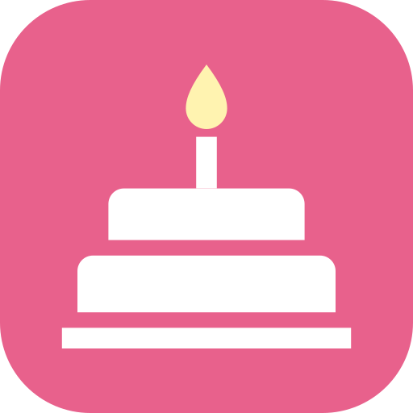

<!-- SPDX-FileCopyrightText: 2026 Stefan Richter -->
<!-- SPDX-License-Identifier: MIT -->
**English** · [Deutsch](README.de.md)

<div align="center">



# Birthday Sync

**Puts the birthdays from your Android contacts into the calendar you actually use – automatically, on your device, without internet access.**

[](https://github.com/brokoskokoli/birthday-sync/actions/workflows/android.yml)
[](https://github.com/brokoskokoli/birthday-sync/releases)
[](LICENSE)
[](#install)

[](https://github.com/brokoskokoli/birthday-sync/releases/latest)

</div>

> **Status:** 0.1.0 is the first public release. See the [changelog](CHANGELOG.md) and the
> [roadmap](#roadmap). Screenshots will follow.

## Why Birthday Sync?

For years, Google Calendar showed your contacts' birthdays automatically. Since 2024 this no
longer works reliably for many users in Germany and the EU – Google cites an agreement with a
German regulator. The birthdays are still in your contacts, they just don't show up in the
calendar any more.

Birthday Sync writes **real calendar events** for these birthdays into a calendar you choose –
for example your Google calendar, so they also appear on the web and on your other devices – and
keeps them up to date. You decide which contacts are included, how the events look and whether
you get a reminder. On top of that, it can send a daily notification listing today's birthdays.

[Birthday Adapter](https://f-droid.org/packages/org.birthdayadapter/) (F-Droid) is a good
choice if a separate local birthday calendar is all you need. Birthday Sync can write into **any**
calendar on the device, including synced accounts, and adds the daily notification.

## Features

- **Choose your contacts** – whole contact accounts (Google, device, Exchange and others) or
  individual groups/labels.
- **Choose your calendar** – any writable calendar on the device, or a local “Birthdays” calendar
  that the app creates for you.
- **Events your way** – all-day or at a set time with a duration, an optional calendar reminder,
  and a title template with `{name}` and `{age}` (default: `🎂 {name} ({age})`).
- **Automatic sync** – daily or weekly in the background (WorkManager), 1–12 months ahead.
- **Keeps the calendar in step** – changed names or birth dates update the events; removed or
  deselected contacts disappear from the calendar.
- **Daily notification** – at a time you choose, only on days when someone has a birthday,
  straight from your contacts.
- **Guided setup** – asks for each permission on its own screen and explains why it is needed.
- **System checks** – battery optimization, background restrictions, app hibernation, exact
  alarms, Battery Saver and hints for manufacturers known to stop background apps.
- **40 languages** – with per-app language selection on Android 13+.
- **Private** – no internet permission, no ads, no tracking, no analytics, no account.
- **Free and open source** – MIT License.

## How the sync works

Every event that Birthday Sync creates carries a marker at the end of its description:
`#birthday-sync key=<contact>_<date> v=<version>`. The app only ever changes events with this
marker, and it needs no database of its own – it finds its events again even after a reinstall.

- Name, title template, time or reminder changed → the version differs → the event is updated.
- Birth date changed, contact deleted or deselected, range shortened → the event is removed (and
  re-created where needed).
- Target calendar changed → the events move to the new calendar.
- Past events are left alone. Future events you delete by hand are created again by the next sync.
- *Calendar → Remove events* deletes all events created by Birthday Sync from all calendars.

## Install

Requirements: **Android 8.0 (API 26) or later**.

- **APK from GitHub:** download `BirthdaySync-<version>.apk` from the
  [latest release](https://github.com/brokoskokoli/birthday-sync/releases/latest) and open it on your
  phone. Android asks you once to allow installing apps from your browser or file manager.
- **Obtainium:** add `https://github.com/brokoskokoli/birthday-sync` in
  [Obtainium](https://github.com/ImranR98/Obtainium) to install the release APK and get updates
  directly from GitHub.
- **Google Play, IzzyOnDroid / F-Droid:** planned.

Updates are installed the same way; your settings are kept. The debug build from source is signed
with a different key and cannot be installed over a release.

### Verify the download

Release APKs are signed with the project's release key. You can check the signature with
`apksigner verify --print-certs BirthdaySync-<version>.apk` (Android SDK build tools) or in
AppVerifier. The SHA-256 fingerprint of the signing certificate is:

```text
98:3B:31:F1:02:F0:75:7F:5F:27:88:A3:10:88:DF:A1:DF:60:97:18:8E:84:00:94:56:37:75:AF:83:DA:CB:40
```

## Quick start

1. Open Birthday Sync. The setup asks for each permission and explains what it is for; you can skip
   steps and complete them later in the *System* tab.
2. *Contacts:* choose the accounts or groups whose birthdays should be included.
3. *Calendar:* choose the target calendar (or create the local “Birthdays” calendar), all-day or
   timed, reminder, title and sync range.
4. *Overview:* tap **Sync now** – from then on the app syncs automatically.
5. *Alerts:* turn on the daily notification and pick a time.

If the sync or the notification doesn't run in the background, check the *System* tab: some
manufacturers stop background apps unless you allow it explicitly.

## Build from source

Requirements: JDK 17 or later (the JetBrains Runtime bundled with Android Studio works) and the
Android SDK (API 36).

```sh
# macOS with Android Studio's JDK (adjust the path on other systems)
export JAVA_HOME="/Applications/Android Studio.app/Contents/jbr/Contents/Home"

./gradlew assembleDebug                 # app/build/outputs/apk/debug/app-debug.apk
./gradlew testDebugUnitTest lintDebug   # unit tests and lint
```

`./gradlew assembleRelease` signs the release APK only if a signing configuration exists: either
`signing/keystore.properties` (keys `storeFile`, `storePassword`, `keyAlias`, `keyPassword`; not in
the repository) or the environment variables `SIGNING_STORE_FILE`, `SIGNING_STORE_PASSWORD`,
`SIGNING_KEY_ALIAS` and `SIGNING_KEY_PASSWORD`. Without them the release APK is unsigned.

## Privacy

Birthday Sync has **no internet permission** and makes no network connections at all. It reads
names, birthdays and account/group membership from your contacts and reads and writes calendar
events – only on your device, and it only ever changes its own birthday events. Settings are
stored locally. There are no ads, no analytics and no tracking. Tapping *Privacy* or *Source code*
in the app opens your browser. Details: [privacy policy](https://brokoskokoli.github.io/birthday-sync/privacy.html).

## Roadmap

- [x] 0.1.0 – first public release (APK on GitHub)
- [ ] Screenshots
- [ ] Google Play
- [ ] IzzyOnDroid / F-Droid
- [ ] Reviewed translations

Ideas and votes are welcome in [Discussions](https://github.com/brokoskokoli/birthday-sync/discussions).

## Translations

The app and its store texts are available in 40 languages. Apart from English and German, many
translations were made with the help of AI. **If you are a native speaker, please help review
them** – the texts are in `app/src/main/res/values-<lang>/strings.xml` and
`fastlane/metadata/android/<locale>/`. Open a
[translation issue](https://github.com/brokoskokoli/birthday-sync/issues/new?template=translation.yml)
or a pull request; see [CONTRIBUTING.md](CONTRIBUTING.md#translations).

## Contributing

Bug reports, ideas, translations and pull requests are welcome. Please read
[CONTRIBUTING.md](CONTRIBUTING.md) first. This project follows the
[Code of Conduct](CODE_OF_CONDUCT.md). Report security issues privately as described in
[SECURITY.md](SECURITY.md).

## License

Birthday Sync is free software under the **MIT License**; see [LICENSE](LICENSE). The repository
follows the [REUSE](https://reuse.software) specification ([REUSE.toml](REUSE.toml)); the Gradle
wrapper is Apache-2.0, the Code of Conduct CC-BY-4.0.

## Acknowledgements

Built with [Kotlin](https://kotlinlang.org), [Jetpack Compose](https://developer.android.com/compose),
[Material 3](https://m3.material.io) and [WorkManager](https://developer.android.com/topic/libraries/architecture/workmanager)
(Apache-2.0).
